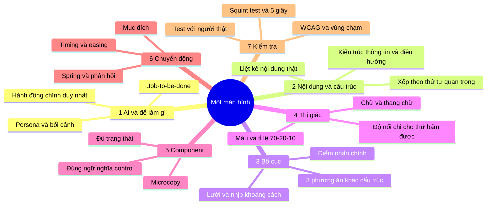

# 05 — Crash course 3 ngày (Critique Loop)

> **v1 · 2026-10-30.** Người dùng chọn học dồn trong 2–3 ngày, theo kiểu hybrid, để làm lại lab2 (D-008, D-009).
> Lộ trình dài `docs/02-roadmap.md` trở thành **deep track** sau lab2 (4 giờ/tuần).
> **Kỳ vọng thật:** 3 ngày cho bạn **bản đồ và ngôn ngữ**: biết tên, biết vì sao, biết tra ở đâu, biết phê bình AI bằng thuật ngữ.
> 3 ngày **không** cho bạn "mắt" và gu. Thứ đó cần nhiều tháng tiếp xúc và lặp lại. Lab2 sẽ là lần lặp đầu tiên.

## Bản đồ tư duy: thiết kế một màn frontend

Đọc từ 1 tới 7. **Lỗi phổ biến nhất (và là lỗi của bạn, W1): nhảy thẳng vào 4 và 5 rồi tối ưu ở đó.**

---

## Critique Loop: một khối học (~75–90 phút)
| # | Bước | Ai | Thời lượng |
|---|---|---|---|
| 0 | **Nhớ lại 3 câu** (quiz) về khối trước. Gợi lại từ trí nhớ giúp nhớ lâu hơn đọc lại nhiều lần (retrieval practice). Bỏ qua ở CC-01 | Claude / bạn | 3' |
| 1 | **Bài giảng ngắn**: khái niệm, vì sao, demo trực quan, phản biện | Claude | 15–20' |
| 2 | **Video bắt buộc** của khối. Subagent làm bài **chạy song song** trong lúc bạn xem | Bạn / subagent | 10–20' |
| 3 | **Dự đoán 2 phút**: trước khi mở bài của subagent, ghi 2–3 dòng "mình đoán AI sẽ làm thế này / sai ở chỗ này" | Bạn | 2' |
| 4 | **Bạn phê bình bài subagent** theo `templates/critique.md`: ≥ 5 vấn đề, ≥ 2 điểm tốt, mỗi điểm có thuật ngữ và hướng sửa | Bạn | 15–20' |
| 5 | **Claude chấm cả hai**: bài subagent, và bài phê bình của bạn. Claude viết bản phê bình tham chiếu **trước khi đọc bài của bạn** để không bị ảnh hưởng | Claude | 10' |
| 6 | **Chắt luật**: điểm nào đáng thành luật thì viết `draft` | Cả hai | 5' |

**Giảm ma sát:** bạn cứ gõ dự đoán và phê bình thẳng vào chat, dạng gạch đầu dòng là đủ. Claude chép vào `lessons/CC-xx-*.md` theo mẫu `templates/critique.md`.
**Mỗi khối một chat mới** (PRC-006). Chuỗi bàn giao giữa hai chat:
`chat CC-n` kết thúc bằng: lesson file (có "Tóm tắt cho khối sau" + 3 câu quiz) → điểm → **brief CC-(n+1)** → PROGRESS → push
`chat CC-(n+1)` mở bằng: clone → đọc → **giao brief cho subagent ngay** → quiz 3 câu từ tóm tắt khối trước → giảng.
Câu mở chat (giống nhau cho mọi khối): *"Gắn repo thiengthb/frontend (quyền push), clone, đọc CLAUDE.md và log/PROGRESS.md rồi bắt đầu khối tiếp theo."*

**Điểm phê bình của bạn** (lưu ở `log/critique-scores.md`) chấm theo 5 trục, mỗi trục 0–2 điểm, tổng 10:
- **Recall**: tìm được bao nhiêu vấn đề quan trọng trong bản tham chiếu
- **Precision**: có chê sai hoặc chê vặt không
- **Ngôn ngữ**: gọi đúng thuật ngữ hay chỉ nói cảm giác
- **Ưu tiên**: xếp đúng mức nghiêm trọng không
- **Hướng sửa**: đề xuất có cụ thể, làm được không

Mục tiêu: khối 1 khoảng 3–4/10, khối cuối ≥ 7/10.

**Nguyên liệu bài tập = lab2 bản cam.** Mỗi khối, subagent làm lại **một khía cạnh** của lab2. Hết ngày 3, bạn có đủ mảnh ghép để làm lại toàn bộ.
Bài subagent là **trang HTML tĩnh 360×800** (khung mobile), được publish thành artifact để bạn xem.

---

## Ngày 1 · NHÌN (4 khối)
| Khối | Chủ đề | Bài tập subagent (trên lab2) | Video bắt buộc |
|---|---|---|---|
| CC-01 | Phân cấp, tương phản, điểm nhấn, squint test; *nhất quán ≠ đồng phục* | GV-001: 3 bố cục khác cấu trúc, không đổi màu | Steve Schoger, *Practical Solutions to Common UI Design Problems* |
| CC-02 | Typography: thang tỉ lệ, đậm/nghiêng/gạch chân khi nào, chữ số, tiếng Việt | Thang chữ mới cho lab2 cùng GV-103 dùng nó | Config 2025, *Typography is the foundation of any design system* (Elliot Jay Stocks) |
| CC-03 | Màu: OKLCH, neutral, semantic, **70-20-10 đúng cách** (tầng phụ = mặt phẳng tổ chức) | GV-001 có tầng 20%, không tô thẻ | Steve Schoger, *How to Think Like a Visual Designer* |
| CC-04 | Lưới, spacing theo quan hệ, nhịp, mật độ, chỉ thứ bấm được mới nổi | GV-102: sửa nhịp và độ nổi | (đọc lại *Refactoring UI*: Layout & Spacing) |

## Ngày 2 · HIỂU NGƯỜI (5 khối)
| Khối | Chủ đề | Bài tập subagent | Video |
|---|---|---|---|
| CC-05 | Tâm lý nhận thức: System 1/2, lướt chứ không đọc, tải nhận thức, Fitts / Hick / Miller (đúng nghĩa), Doherty, peak-end | Phân tích GV-001 qua 6 định luật | Jon Yablonski, *Laws of UX* |
| CC-06 | 10 heuristic Nielsen và 7 nguyên tắc Norman (affordance, signifier, mapping, feedback) | Heuristic evaluation toàn luồng điểm danh lab2 | NN/g (kênh @NNgroup), các video heuristic |
| CC-07 | Nghiên cứu người dùng tối thiểu: Mom Test, JTBD, usability test 5 người, think-aloud | Kịch bản usability test 5 nhiệm vụ cho lab2 | *The Mom Test* (phỏng vấn Rob Fitzpatrick) |
| CC-08 | **Quy chuẩn & con số**: WCAG 2.2 (contrast 4.5:1, 3:1), vùng chạm 24/44/48, focus ring, reduced motion. *Đây là những thứ AI đã làm hộ bạn; giờ bạn phải hiểu* | Audit a11y lab2 kèm bảng số liệu có nguồn | (đọc *Understanding WCAG 2.2*: 1.4.3, 1.4.11, 2.4.7, 2.5.8) |
| CC-09 | Component đúng ngữ nghĩa: nút, chọn và bật/tắt, form, nav, card/list/table, overlay, các trạng thái | GV-102: thay 35 switch bằng mẫu đúng | Apple WWDC18, *The Life of a Button* |

## Ngày 3 · CHUYỂN ĐỘNG & ÁP DỤNG (4 khối)
| Khối | Chủ đề | Bài tập subagent | Video |
|---|---|---|---|
| CC-10 | Animation 1: vì sao UI chuyển động, 12 nguyên lý Disney áp vào UI, timing, easing | Bản đặc tả chuyển động cho luồng điểm danh (bảng: sự kiện → thời lượng → easing → lý do) | Alan Becker, *12 Principles of Animation (Official Full Series)* |
| CC-11 | Animation 2: spring, biên đạo/stagger, micro-interaction, hiệu năng (transform/opacity), reduced motion | Prototype HTML: nút "Chốt", thẻ thành công, hoàn tác, có spring | Apple WWDC18, *Designing Fluid Interfaces*; WWDC23, *Animate with springs* |
| CC-12 | Art-direct AI: brief, nhận diện AI slop, dịch cảm giác thành thuật ngữ | Bạn viết brief → subagent dựng GV-001 → bạn phê bình | — |
| CC-13 | **Kickoff làm lại lab2**: gom luật ngày 1–3, chọn hướng, lập kế hoạch Figma | Subagent dựng 3 hướng hoàn chỉnh cho GV-001 | — |

**Sau CC-13:** bạn làm lại lab2 trên Figma (qua AI, theo luật vừa chốt). Claude review như với thầy.

---

## Giữ sức
- Tối đa **4–5 khối/ngày**, nghỉ 10 phút sau mỗi khối. Sau 5 khối, chất lượng phê bình sẽ tụt, và điểm trong `critique-scores.md` sẽ cho thấy điều đó.
- Nếu một khối dưới 4/10, **làm lại khối đó** với một bài subagent khác trước khi sang khối mới.
